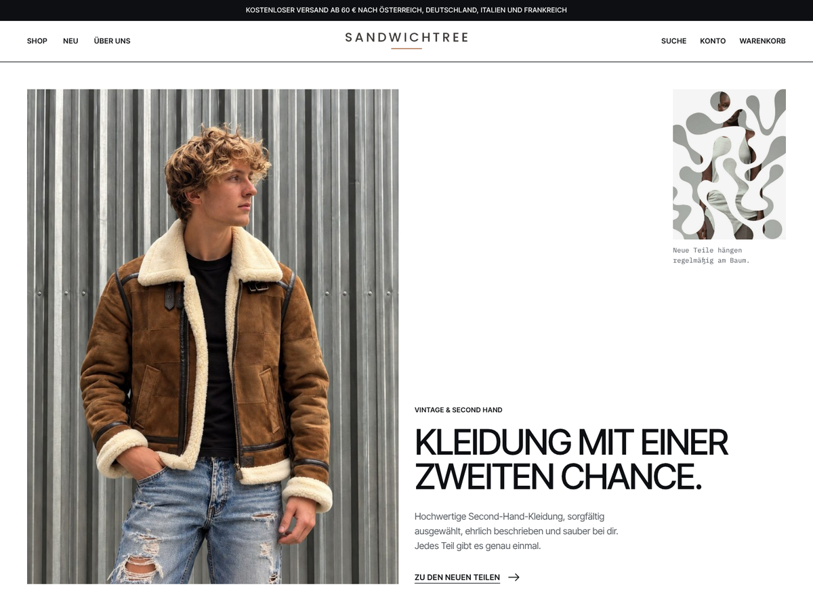

# Sandwich Tree – WooCommerce-Theme

WordPress-Theme für den Vintage- und Second-Hand-Shop **Sandwich Tree**.
Jedes Teil ist ein Unikat (Bestand 1), mit Vintage-Details wie Größe, Zustand und Maßen,
Verkauft-Kennzeichnung und Vinted-Erinnerung gegen Doppelverkäufe.



> **Hinweis:** GitHub speichert hier nur den Code. Die Website läuft nicht auf GitHub Pages,
> weil WordPress PHP und eine Datenbank braucht. Das Theme wird auf einem WordPress-Hosting installiert.

## Theme installieren

**Variante A: fertiges ZIP aus einem Release (empfohlen)**

1. Rechts auf dieser Seite unter **Releases** die neueste Version öffnen.
2. `sandwichtree.zip` herunterladen.
3. In WordPress: **Design → Themes → Theme hochladen**, ZIP auswählen, aktivieren.

**Variante B: direkt aus dem Repository**

1. **Code → Download ZIP** klicken.
2. In WordPress unter **Design → Themes → Theme hochladen** dieses ZIP hochladen.
   Der Theme-Ordner heißt dann z. B. `sandwichtree-main`. Das funktioniert, ist aber weniger schön als Variante A.

Danach: WooCommerce installieren und unter **Design → Sandwichtree einrichten** auf „Jetzt einrichten“ klicken.
Alle weiteren Schritte und die Checkliste vor dem Livegang stehen in [LIESMICH.md](LIESMICH.md).

## Neue Version veröffentlichen

1. Änderungen committen und pushen.
2. In `style.css` und `functions.php` die Versionsnummer erhöhen (z. B. `1.7.2` → `1.7.3`).
3. Auf GitHub **Releases → Draft a new release**, als Tag z. B. `v1.7.3` eintragen und veröffentlichen.
4. Die GitHub-Aktion „Theme-ZIP bauen“ hängt nach etwa einer Minute automatisch `sandwichtree.zip` an das Release.

Unter **Actions → Theme-ZIP bauen → Run workflow** kannst du das ZIP auch ohne Release erzeugen.
Es liegt dann als Download („Artifact“) beim jeweiligen Lauf.

## Automatische Updates in WordPress (optional)

Mit dem Plugin **Git Updater** zeigt WordPress neue Versionen aus diesem Repository als Update an.
Dafür in `style.css` unter `Text Domain` diese Zeile ergänzen (eigenen Benutzernamen einsetzen):

```
GitHub Theme URI: DEIN-BENUTZERNAME/sandwichtree
```

Bei einem privaten Repository braucht Git Updater zusätzlich einen GitHub-Zugriffstoken (Einstellungen des Plugins).

## Aufbau

| Pfad | Inhalt |
|---|---|
| `style.css`, `functions.php` | Theme-Kopf und Einstiegspunkt |
| `header.php`, `footer.php`, `front-page.php`, `page.php` … | Seitenvorlagen |
| `inc/woocommerce.php` | Shop-Darstellung: Produktkarten, Produktseite, Warenkorb |
| `inc/vintage.php` | Unikat-Logik, Vintage-Details, Vinted-Erinnerung |
| `inc/customizer.php` | Texte, Bilder und Links, die der Shop selbst ändert |
| `inc/demo-import.php`, `inc/placeholder-images.php` | Einrichtungsseite mit Beispielinhalten |
| `assets/css/main.css` | Gestaltung (Farben und Schriften oben als Variablen) |
| `assets/fonts/`, `assets/img/` | Schriften (lokal, SIL OFL) und Logo |

Lizenz: GPL v2 oder neuer. Schriften: SIL Open Font License (siehe `assets/fonts/OFL.txt`).
